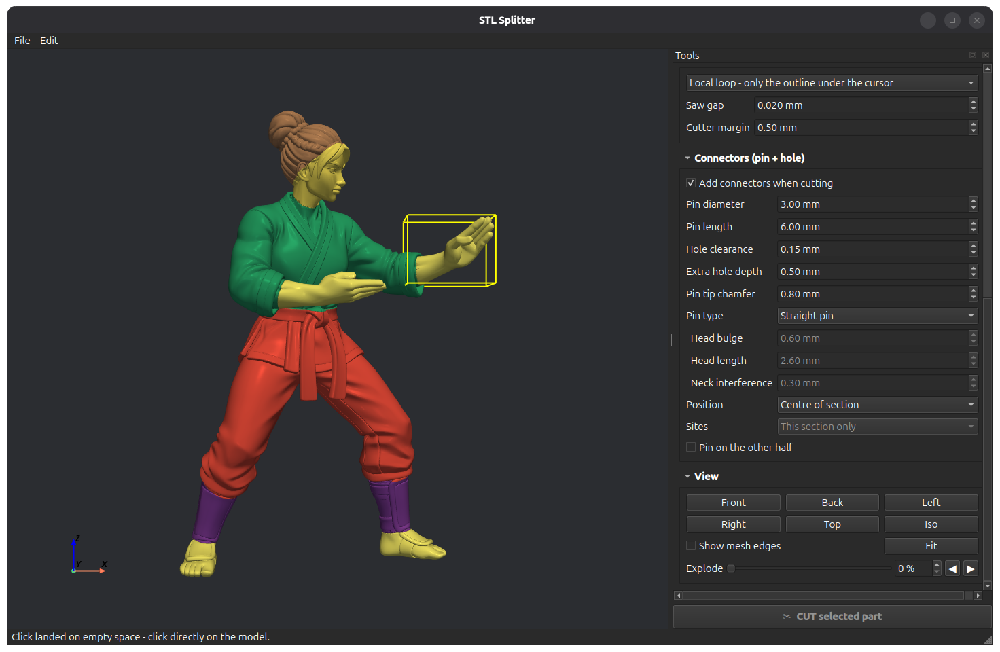
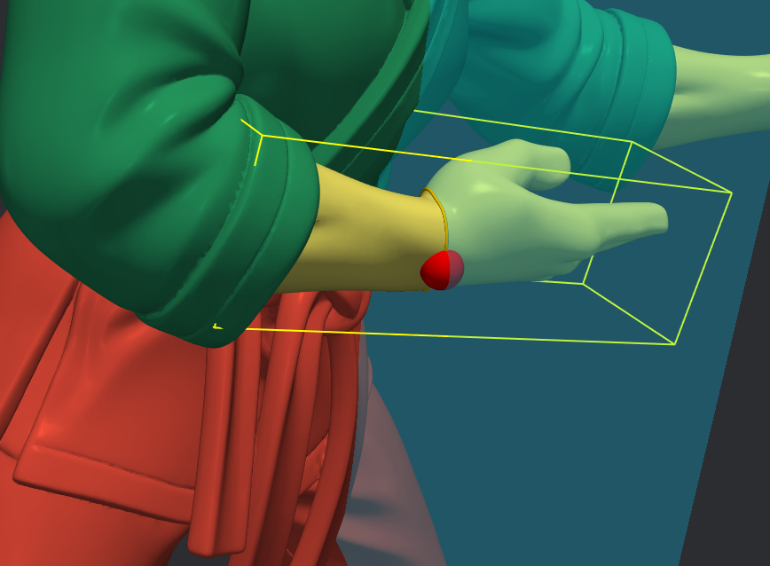
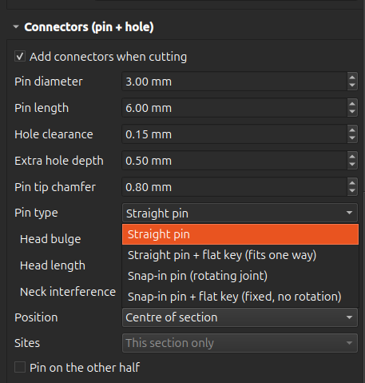
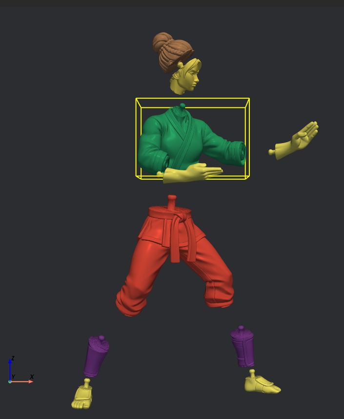
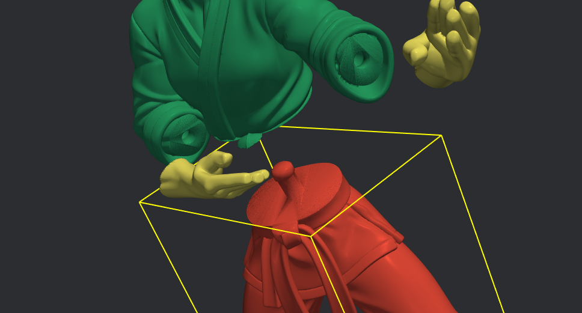

# STL Splitter

**Turn any STL figure into a multi-colour, snap-together construction kit.**

Click on a model, see exactly where the cut will go, press one button, and get two parts with a matching **pin and hole** already built in. Repeat for wrists, ankles, neck, whatever you like, give every part its own colour, and export the lot ready for printing.


<p align="center">
  
</p>

## Why?

Printing a miniature in several colours on a single-nozzle printer means cutting it into parts, printing each in its own filament and gluing or snapping them together. The usual tools cut with one infinite plane through the whole model and leave you to design the joints by hand.

STL Splitter is built for exactly this job:

- **Cut one limb at a time.** The *local loop* mode works like a thread pulled tight around the outline under your cursor. Other body parts the same plane passes through (the other ankle, say) stay untouched.
- **See before you cut.** A 3D cursor, a plane and a yellow outline show precisely what will be separated.
- **Joints included.** Pins and holes are generated automatically, sized to fit the section, with several joint types, including a **snap-in pin** for rotating joints.
- **Colour preview.** Give every part a colour and see how the finished figure will look, even in an exploded view.

## Features

### Cutting
- **Click-to-place 3D cursor** on the surface of the model; the cut plane starts out perpendicular to the local surface.
- **Auto-snap** turns the plane to the *thinnest cross-section* through the clicked point, which is the right direction across a wrist, ankle, neck or sleeve.
- **Spin, Tilt and Offset** sliders with fine ◀ ▶ nudge buttons (0.1 mm for the offset, 0.5° for the angles).
- **Two cut modes**
  - **Local loop**: cuts only the outline under the cursor.
  - **Infinite plane**: cuts everything the plane touches; optional connectors on every section.
- Detects when an outline cannot separate the model (rings, handles) and tells you instead of failing silently.
- **Undo** (20 steps) that keeps your cursor and plane settings, so you can retry a cut with different options without re-tuning the plane.

### Connectors
| Pin type | Use it for |
|---|---|
| **Straight pin** | Simple glued joints |
| **Straight pin + flat key** | Glued joints that must go together in one orientation |
| **Snap-in pin** | Rotating joints: a thicker head is pressed past a narrower neck into a cavity. Holds by friction and turns freely. |
| **Snap-in pin + flat key** | Firm joints that hold on their own but must not rotate |

All sizes are adjustable: pin diameter, pin length, hole clearance, extra hole depth, tip chamfer and, for snap-in pins, head bulge, head length and neck interference. If a section is too thin the pin is automatically reduced to leave wall around the hole, and you are told about it.

### Viewing and parts
- Rotate, zoom and pan with the mouse, standard views (front, back, left, right, top, isometric) and an optional mesh-edge display.
- **Explode slider** to pull the parts apart and inspect the joints.
- Parts list with colour picker, rename, delete and per-part visibility.

### Saving
- **Save collection**: one STL per part plus a `collection.json` that remembers names, colours and visibility. Reopen it later with *Open collection*. Asks before replacing existing files.
- **Export 3MF**: a single file with every part in its assembled position and a colour per part.

## Screenshots

| Place the cursor, check the yellow outline | Choose the pin type |
|:---:|:---:|
|  |  |

| Exploded view with colours | Pin and hole close up |
|:---:|:---:|
|  |  |

## Installation

Requires **Python 3.10 or newer**.

```bash
git clone https://github.com/<your-name>/stl-splitter.git
cd stl-splitter
python -m venv .venv
source .venv/bin/activate        # Windows: .venv\Scripts\activate
pip install -r requirements.txt
```

Run it:

```bash
python stl_splitter.py                 # then File > Open STL
python stl_splitter.py my_figure.stl   # or open a model directly
```

## Quick start: a karate figure in colour

1. **Open** your STL.
2. **Click** on the left wrist. The red dot, the cyan plane and a yellow outline appear. With *Auto-snap* on, the plane turns across the arm by itself.
3. Check the **yellow outline**: that is exactly the cut. Fine-tune with Spin, Tilt and Offset if needed.
4. Choose a **pin type** and size in *Connectors*, then press **CUT**.
5. Repeat for the other wrist, both ankles and the neck. Cut the hand off *before* the foot, or the other way around; the order does not matter.
6. Pick a **colour** for each part, try the **Explode** slider to check how it looks.
7. **Save collection** (STL files) or **Export 3MF**, and load the parts into your slicer.

> **Mouse:** left-drag rotates · wheel or right-drag zooms · middle-drag pans · left-*click* places the cursor.
> Spin boxes and sliders react to the mouse wheel only after you have clicked into them, so scrolling the panel never changes values by accident.

## Printing tips

- **Clearance:** 0.10–0.20 mm is a good starting point for FDM; test one joint before printing the whole figure.
- **Snap-in joints:** start with neck interference around 0.2–0.3 mm for PLA and 0.3–0.4 mm for PETG. If the pin will not go in, or the part cracks, lower it. If the joint is loose, raise it.
- **Orientation:** print the part with the hole facing up if you can, so the layers run around the hole and the rim is stronger. The 45° shoulder under the snap head prints without supports when the pin points up.
- **Thin sections:** a very thin wall around a snap cavity can crack when the head is pressed in. Use a larger section or a smaller head bulge.
- **Colours in the slicer:** if 3MF colours do not show up in your slicer, load the per-part STL files together and accept the "multi-part object" prompt; the parts keep their positions and you can assign a filament to each one.

## Limitations

- The model must be **watertight**. The app tries to repair small holes on loading and warns you if it cannot. Very broken meshes need repairing first (Blender's 3D-Print Toolbox, Meshmixer, 3D Builder).
- Cuts are **flat**; stepped or curved cuts are not supported.
- A *local loop* cannot separate a **ring** (for example an arm pressed against the hip). Make a second cut elsewhere on the ring, or use the infinite plane.
- Local cuts leave a tiny saw gap (0.02 mm by default, adjustable) between the two halves.
- How well 3MF colours import depends on the slicer.
- Developed and tested on Linux. The libraries used are cross-platform, but Windows and macOS have had less testing, so please open an issue if something misbehaves.

## Troubleshooting

- **`Could not load the Qt platform plugin "xcb"` on Linux:** install the missing system library, e.g. `sudo apt install libxcb-cursor0`.
- **Black or empty 3D view:** update your graphics driver; on some Wayland setups, try `QT_QPA_PLATFORM=xcb python stl_splitter.py`.
- **A cut fails with a message:** read it; it usually says how to fix it (move the plane, reduce the pin size, switch the cut mode, repair the mesh). Use **Ctrl+Z** to undo and try again.

## How it works

The project is two small files:

- `stl_splitter.py`: the PySide6 + PyVista interface (viewer, picking, panels).
- `splitter_core.py`: the geometry, with no GUI dependency: loading and repair, plane cutting, the local "thread" cut, pin and hole generation, collection and 3MF export. Boolean operations use [manifold3d](https://github.com/elalish/manifold) through [trimesh](https://trimesh.org).

Because the core has no GUI imports, you can also use it from scripts:

```python
import numpy as np
import splitter_core as core

mesh, watertight = core.load_mesh("figure.stl")
origin = np.array([10.0, 0.0, 35.0])          # a point on the cut plane
normal = np.array([0.0, 0.0, 1.0])            # plane normal
pin = core.ConnectorParams(diameter=3, length=6, snap=True)

lower, upper, note = core.cut_part(mesh, origin, normal, origin, pin, mode="local")
print(note, len(lower), len(upper))
```

## Contributing

Issues and pull requests are welcome. Ideas that would make it better: relief slits for snap sockets, several pins per cut face, curved cut surfaces, saving and restoring the whole session, and a lay-flat export for printing.
